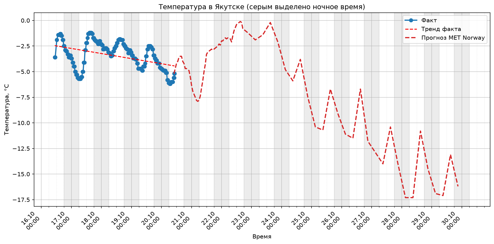

# Weather Collector Yakutsk 🌡️

Приложение на Python для сбора, анализа и визуализации погодных данных в Якутске.

## 📌 Возможности
- Получение актуальной погоды/прогноза погоды через API MET Norway (бесплатно, без ключей).
- Сохранение истории наблюдений в `CSV`.
- Расчёт статистики (среднее, медиана, мин/макс, стандартное отклонение).
- Визуализация данных в виде графика с линией тренда (matplotlib).

## 🛠 Стек
- Python 3.12
- `requests` (работа с API)
- `matplotlib` (визуализация)
- `csv`, `statistics`, `datetime` (стандартная библиотека)

## 🚀 Как запустить
1. Клонируйте репозиторий.
2. Создайте и активируйте виртуальное окружение:
   ```bash
   python -m venv .venv
   source .venv/bin/activate  # для Linux/macOS
   .venv\Scripts\activate     # для Windows
3. Установите зависимости:
    ```bash
    pip install -r requirements.txt
4. Запустите сбор данных:
    ```bash
    python main.py
📈 Результат
После сбора данных в папке появится файл temperature.png с графиком температуры и линией тренда.

