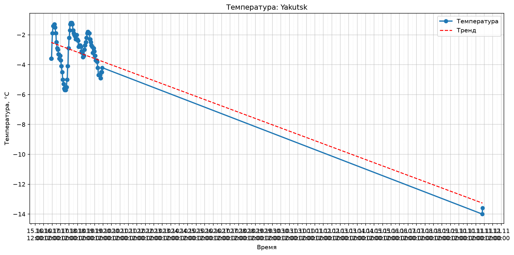

# Weather Collector 2.0 — Якутск

Сбор, нормализация, сравнение и объединение прогнозов двух независимых
источников: **MET Norway** и **Open-Meteo**. История наблюдений хранится в
SQLite, старый CSV сохраняется и переносится автоматически.

## Возможности

- прогноз MET Norway (compact) и Open-Meteo (почасовой, 7 дней);
- единая структура данных с временем в UTC и `None` для отсутствующих значений;
- объединённый прогноз только при наличии обоих источников;
- расхождения по температуре, влажности, ветру, осадкам и вероятности осадков;
- независимая работа источников: отказ одного не ломает второй;
- SQLite (`data/weather.db`) + безопасная идемпотентная миграция старого CSV;
- статистика, графики прогноза и исторической динамики;
- локальный FastAPI backend;
- Docker Compose для запуска коллектора и API на Windows 11.

Объединённый прогноз — **производный прогноз приложения** (равные веса), а не
прогноз MET Norway или Open-Meteo. Он не объявляется более точным: точность
на исторических данных не проверялась.

## Архитектура

```
main.py ──> weather_service.collect_once()
              ├─ weather_api.fetch_metno_forecast()      (MET Norway)
              ├─ open_meteo_api.fetch_open_meteo_forecast()
              ├─ forecast_merge.build_combined_forecast()
              └─ weather_db (SQLite) + plotter
api.py ──> weather_service ──> weather_db / weather_calc
```

HTTP-слой (`weather_http.py`) отвечает за timeout, повторы только временных
ошибок, rate limit и TTL-кэш. Оба источника получают координаты из
`weather_api_config.py` / `.env`.

## Быстрый старт (Windows)

```powershell
python -m venv .venv
.\.venv\Scripts\activate
pip install -r requirements.txt
copy .env.example .env
# откройте .env и укажите WEATHER_CONTACT_EMAIL — этого требует MET Norway
python main.py
```

`main.py` собирает прогнозы и текущую погоду, сохраняет их, строит графики и
повторяет цикл каждые 30 минут. Остановка — `Ctrl+C` (или `SIGTERM` в Docker).

API запускается отдельно:

```powershell
.\.venv\Scripts\python -m uvicorn api:app --host 127.0.0.1 --port 8000
```

Swagger: http://127.0.0.1:8000/docs

API не ходит в сеть на каждый запрос: он читает последние данные из SQLite,
поэтому сначала должен отработать коллектор.

## Конфигурация

Все параметры читаются из `.env` (образец — `.env.example`) или переменных
окружения. Секретов в коде нет.

| Переменная | По умолчанию | Назначение |
|---|---|---|
| `WEATHER_CITY` | `Yakutsk` | город в подписях |
| `WEATHER_LAT` / `WEATHER_LON` | `62.01436` / `129.7124` | координаты для обоих API |
| `WEATHER_TIMEZONE` | `Asia/Yakutsk` | часовой пояс для отображения и миграции CSV |
| `WEATHER_CONTACT_EMAIL` | — | контакт в User-Agent MET Norway |
| `WEATHER_INTERVAL_MIN` | `30` | интервал цикла коллектора |
| `WEATHER_PLOT_EVERY` | `5` | как часто печатать статистику |
| `WEATHER_TIMEOUT_SEC` | `15` | timeout чтения HTTP |
| `WEATHER_CURRENT_MAX_AGE_HOURS` | `6` | после этого `/weather/current` отдаёт 404 |
| `WEATHER_DB_PATH` | `data/weather.db` | путь к SQLite |
| `WEATHER_PLOTS_DIR` | `data/plots` | каталог графиков прогноза |

## API

| Метод и путь | Что возвращает | Ошибки |
|---|---|---|
| `GET /health` | состояние приложения и SQLite | 503 |
| `GET /weather/current` | последнее свежее наблюдение | 404 |
| `GET /weather/forecast` | строки MET / Open-Meteo / combined / diff | 503 |
| `GET /weather/forecast/sources` | последние снимки каждого источника | 503 |
| `GET /weather/forecast/combined` | сохранённый объединённый прогноз | 503 |
| `GET /weather/forecast/differences` | расхождения (Open-Meteo − MET Norway) | 503 |
| `GET /weather/history?limit=100&since=...` | история наблюдений из SQLite | 422 |
| `GET /weather/statistics` | статистика наблюдений и сравнение прогнозов | — |

Примеры:

```powershell
curl http://127.0.0.1:8000/health
curl http://127.0.0.1:8000/weather/forecast
curl "http://127.0.0.1:8000/weather/history?limit=10"
```

`weather_code` приведён к WMO: Open-Meteo отдаёт WMO напрямую, `symbol_code`
MET переводится приблизительной таблицей (исходный код сохраняется в
`weather_symbol`). Коды погоды не усредняются: при расхождении combined-код
равен `null`, а оба исходных кода видны в строках источников.

## Данные и хранение

- `data/weather.db` — основное хранилище: `observations`, `forecast_points`,
  `combined_points`, `update_log`, `meta`.
- `weather_history.csv` не удаляется и не перезаписывается. При первом запуске
  старые строки один раз переносятся в SQLite; наивное локальное время CSV
  трактуется в `WEATHER_TIMEZONE` и переводится в UTC. Повторный запуск
  миграции ничего не дублирует.
- Снимки прогнозов накапливаются для истории; очистка/retention пока не
  реализованы.
- Резервная копия — скопировать каталог `data/` (при остановленном приложении).

## Графики

- `temperature.png` — историческая динамика температуры с трендом (тренд только
  при ≥2 точках);
- `data/plots/forecast_temperature.png` — MET / Open-Meteo / combined;
- `data/plots/forecast_wind.png` — скорость ветра;
- `data/plots/forecast_precipitation_probability.png` — вероятность осадков;
- `data/plots/forecast_precipitation.png` — количество осадков;
- `data/plots/forecast_differences.png` — расхождения по 4 параметрам.

Пропущенные значения не заменяются нулями, поэтому линии могут обрываться.
Вероятность осадков у MET compact отсутствует — на графике будет только
Open-Meteo.

## Тесты

```powershell
pip install -r requirements-dev.txt
python -m pytest
```

Тесты не обращаются к реальным погодным API: HTTP-слой и ответы источников
мокируются. Покрыты успешные и битые ответы, timeout/retry, отказ одного
источника, нормализация, синхронизация по UTC, combined, круговое среднее
ветра, расхождения, SQLite, миграция CSV и FastAPI endpoints.

## Docker (Windows 11 + Docker Desktop)

1. Установите и запустите Docker Desktop.
2. Создайте `.env` из `.env.example` и заполните контакт.
3. Запустите:

```powershell
docker compose up --build -d
docker compose ps
curl http://127.0.0.1:8000/health
```

Сервисы:

- `collector` — `python main.py`, постоянный цикл сбора;
- `api` — `uvicorn api:app` на `127.0.0.1:8000`, стартует после healthy
  коллектора;
- общий volume `weather-data` смонтирован в `/app/data`, поэтому SQLite и
  графики переживают перезапуск контейнеров;
- у обоих сервисов есть healthcheck.

Остановка с сохранением данных:

```powershell
docker compose down
```

Удаление вместе с данными (осторожно):

```powershell
docker compose down -v
```

Логи:

```powershell
docker compose logs -f collector
docker compose logs -f api
```

## Структура проекта

```
main.py               цикл сбора
weather_service.py    сервисный слой (общий для CLI и API)
api.py, api_models.py FastAPI и Pydantic-модели
weather_api.py        MET Norway: текущая погода и прогноз
open_meteo_api.py     Open-Meteo: прогноз
weather_http.py       timeout, retry, rate limit, кэш
weather_common.py     единая схема точек
forecast_merge.py     синхронизация, combined, расхождения
weather_db.py         SQLite
weather_storage.py    CSV-совместимость и миграция
weather_calc.py       статистика и сравнение
plotter.py            графики
weather_api_config.py центральная конфигурация
tests/                pytest
Dockerfile, docker-compose.yml
```

## Ограничения

- MET compact не отдаёт вероятность осадков, порывы, снег и apparent
  temperature — эти поля остаются `None`; объединённые значения по ним
  недоступны.
- MET через несколько суток переходит на шаг 6 часов, поэтому combined
  строится только по точным совпадениям часов; интерполяции нет.
- 6-часовые суммы осадков MET не сравниваются с почасовыми Open-Meteo.
- Снег Open-Meteo приходит в сантиметрах; MET снег не отдаёт.
- Проект локальный: без авторизации и многопользовательского режима.


